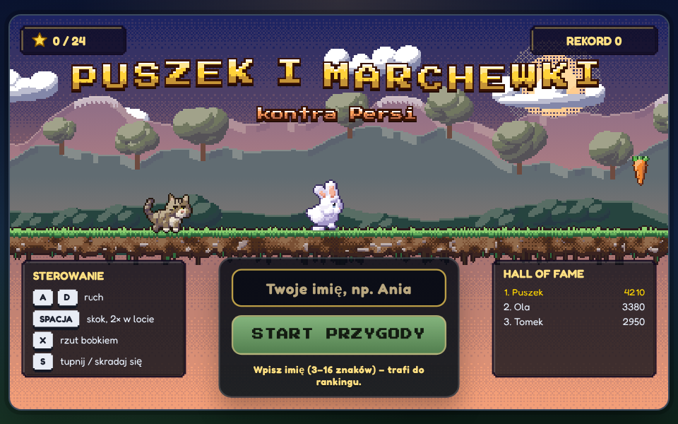
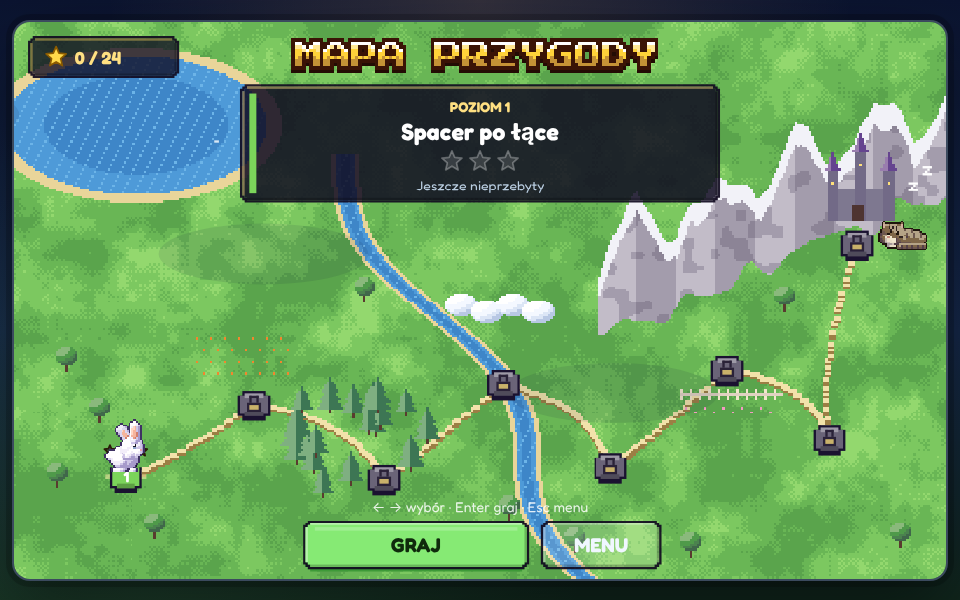
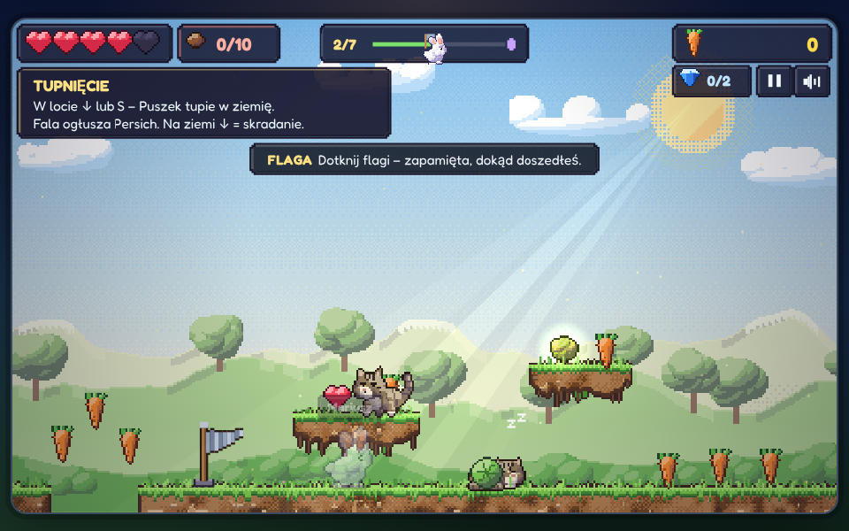
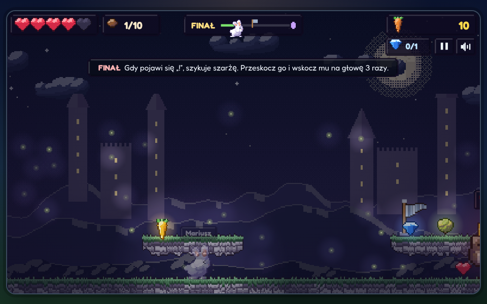

# 🐰 Puszek i marchewki kontra Persi

Pixel-artowa platformówka w **jednym pliku HTML**: bez instalacji i bez bibliotek, działa w przeglądarce na komputerze i telefonie.
Bohaterowie mają prawdziwe pierwowzory: królika **Puszka** (biały, z grzywką i krótkimi brzoskwiniowymi uszkami) i kota **Persiego** (bury tygrysek z literą „M” na czole).

### ▶ [Zagraj](https://mariuszbelka.github.io/przygody-krolika/)  ·  🧩 [Przygoda 2: Sroka Złodziejka](https://mariuszbelka.github.io/przygody-krolika/przygoda2/)  ·  🌲 [Przygoda 3: Zaczarowany Las](https://mariuszbelka.github.io/przygody-krolika/przygoda3/)



## O grze
Puszek wędruje przez osiem krain po marchewki i diamenty, a po drodze zastawia na niego pułapki Persi.
Każda kraina ma własną mechanikę:

| # | Kraina | Mechanika |
|---|---|---|
| 1 | Łąka | grzyby-trampoliny |
| 2 | Pagórki | toczące się kapusty |
| 3 | Las (w deszczu) | kłody spadające chwilę po wejściu |
| 4 | Chmury | wiatr: pod wiatr i z wiatrem |
| 5 | Strumień | lilie tonące pod Puszkiem |
| 6 | Ogród | zraszacze wystrzeliwujące w górę |
| 7 | Zamek | kruszące się cegły i chowające się kolce |
| 8 | Finał | Wielki Persi i spadające kłębki włóczki |

Za każdy poziom można zdobyć do 3 gwiazdek: za metę, za wszystkie diamenty i za przejście bez utraty serca.
Śpiącego Persiego da się minąć na paluszkach, a tupnięcie z powietrza go ogłusza.





## Sterowanie
| Komputer | Akcja |
|---|---|
| A / D lub ← / → | ruch |
| Spacja / W / ↑ | skok (drugi skok w locie) |
| X | rzut bobkiem |
| S / ↓ | w locie tupnięcie, na ziemi skradanie |
| Esc | pauza |
| M | muzyka |

Na telefonie duże przyciski pojawiają się pod planszą. Najwygodniej grać poziomo, w trybie pełnoekranowym.

## Ranking dla znajomych (hall of fame)
Ranking działa tylko z linku z kodem ekipy:

```
https://mariuszbelka.github.io/przygody-krolika/?ekipa=znajomi
```

Każdy kod (litery, cyfry, myślnik) to osobna tabela wyników. Wynik trafia do rankingu po przejściu całej przygody od poziomu 1 albo po utracie wszystkich serc.
Bez kodu w linku gra działa normalnie, tylko bez rankingu.

Wyniki przechowuje Supabase (darmowy plan). Schemat tabeli jest w [`supabase_ranking.sql`](supabase_ranking.sql).
Klucz `sb_publishable_…` w kodzie jest publiczny z założenia. Dostęp ogranicza RLS: wolno tylko czytać i dopisywać.
Ranking chroni wyłącznie nieznajomość linku, więc nie jest zabezpieczony przed wpisaniem fałszywego wyniku.

## Technicznie
- Jeden plik `index.html`, czysty JavaScript i Canvas 2D, logiczna rozdzielczość 800×480 z ostrym renderingiem HiDPI.
- Proceduralny pixel-art: sprite'y generowane w kodzie, z cieniowaniem i światłem.
- Muzyka i efekty generowane na żywo przez WebAudio, bez plików dźwiękowych.
- Czcionki (Fredoka, Press Start 2P) są wbudowane w plik, więc gra wygląda tak samo offline.
- Postęp (gwiazdki, najlepsze czasy) zapisuje się lokalnie w przeglądarce.
- Wszystkie poziomy przeszedł automatyczny bot bez utraty serca. Precyzję skoków mierzono z celowo „rozjechanym” timingiem ±50 i ±100 ms.

## Uruchomienie lokalne
Wystarczy otworzyć `index.html` w przeglądarce.

## Przygoda 2: Sroka Złodziejka (`/przygoda2/`)
Turowa gra logiczna: Puszek i Persi działają razem przeciw Sroce Szarlotce. Liczy się kombinowanie, a nie refleks.
Przełączasz postacie, ruch można cofać, są podpowiedzi.

| Puszek | Persi |
|---|---|
| wskakuje na 1 kratkę | wskakuje na 2 kratki |
| kopie miękką ziemię | pcha skrzynki |
| przechodzi przez nory | drapie liny |

Obie postacie mogą wejść jedna na drugą, stanąć na płycie i przełączyć dźwignię.
Gra ma 15 pokoi w 4 krainach (Ogród, Szopa, Piwnica, Wieża Sroki).

**Sterowanie:** ← → ruch, Spacja akcja, Tab zmiana postaci, Z cofnij, R od nowa, H podpowiedź.

Każdy pokój sprawdza solver BFS (`przygoda2/tools/solve.js`). Ten sam plik `rules.js` steruje grą i solverem.
Solver wyznacza też liczbę ruchów „mistrza”: minimum +10%.
`tools/check.js` sprawdza, czy skrzynki, nory i ziemia są w pokoju naprawdę potrzebne.

## Przygoda 3: Zaczarowany Las (`/przygoda3/`)
Szybka platformówka na silniku z części 1. Na starcie wybierasz, czy grasz Puszkiem, czy Persim:

| | Umiejętności |
|---|---|
| **Puszek** | podwójny skok, bobki, tupnięcie |
| **Persi** | szybszy, skacze wyżej, wspina się po pnączach, zryw z pazurkami przebija wrogów |

Leśne Licho zaczarowało las. Pokonani wrogowie zostają **odczarowani**.

| Wróg | Uwaga |
|---|---|
| muchomorki | – |
| żabki | – |
| jeże | nie wolno skakać im na grzbiet |
| wiewiórki | rzucają szyszkami |
| Bzyczki | – |
| boss Grzybowy Król | 6 serc, 3 fazy (fale uderzeniowe, salwy zarodników, przywołane muchomorki); po każdym trafieniu odskakuje i jest chwilę nietykalny; zryw i taran się od niego odbijają |

**Zbieranie:** dużo żołędzi z mnożnikiem serii, słoiki ze świetlikami (gwiazdka), złote żołędzie w sekretach.
**Moce:** magnes, bańka, Turbo-marchew. Po trafieniu żołędzie się rozsypują i można je odzyskać.
**Kraina 1, Polana Grzybów:** Leśna ścieżka, Korony drzew, Jeżynowy gąszcz, pościg Wiatrołom i finał z Grzybowym Królem.
Poziomy mają 8,5–10,5 tys. px (ok. 2,5× dłuższe niż w pierwszej wersji), z 3–4 punktami kontrolnymi każdy.
Mapa świata to leśna polana ze ścieżką, a w tle widać kolejne krainy: Mokradła i Mgłę oraz Drzewo Licha.
Źródła poziomów, grafiki i mapy są w `przygoda3/tools/`, a `patch_p3.py` składa z nich grę na bazie części 1.

Poziomy sprawdza walidator osiągalności dla obu postaci (`przygoda3/tools/validate3.js`).
Bot przeszedł każdy poziom obiema postaciami bez utraty serca.
Ranking działa z tym samym kodem `?ekipa=`, ale osobno dla części 3.
